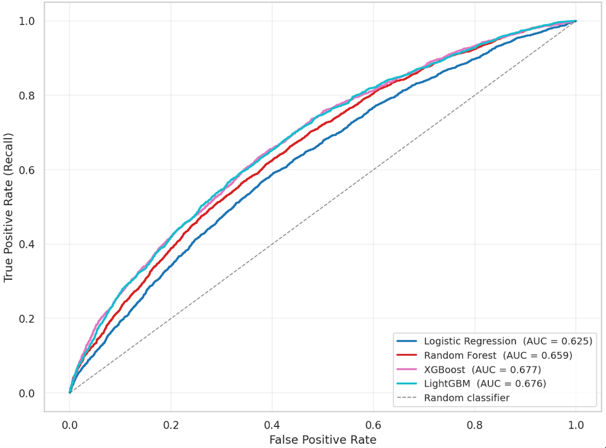
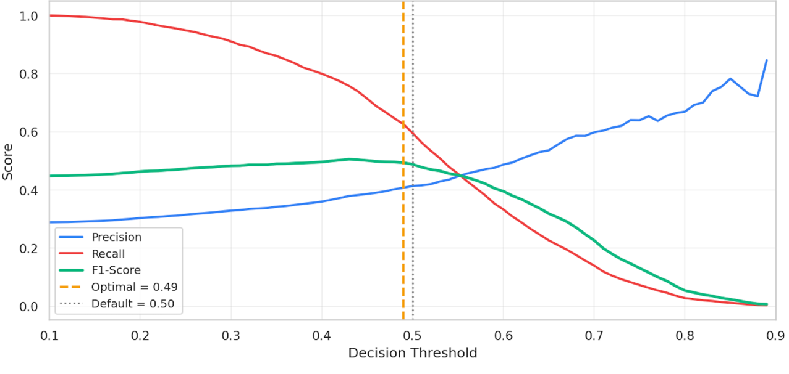
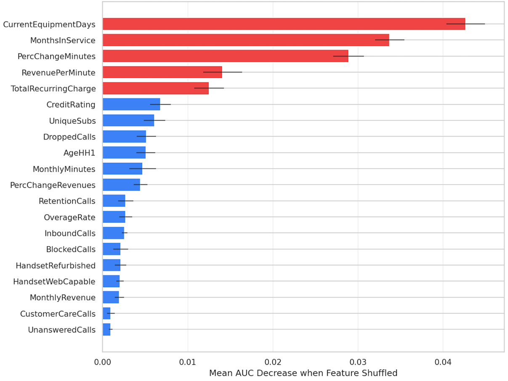
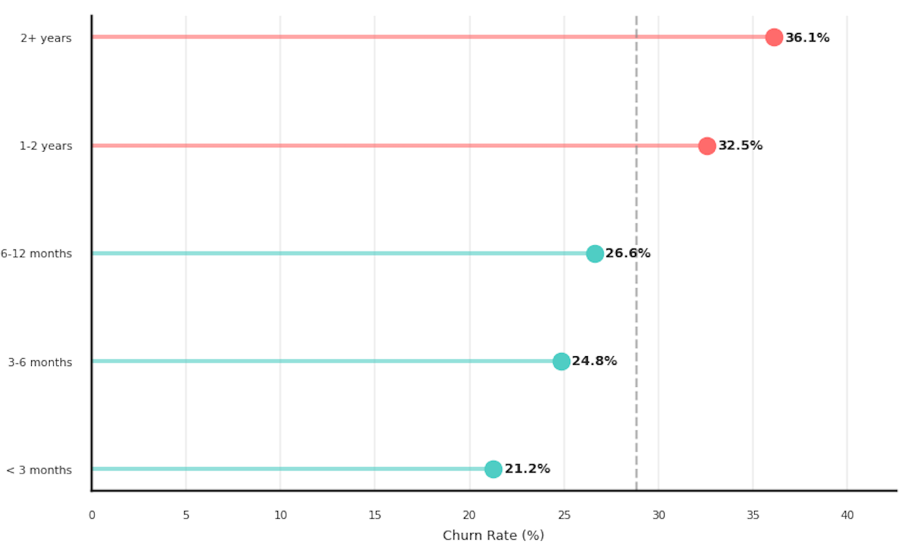

# Customer Churn Prediction — Cell2Cell Telecom


End-to-end machine learning project that predicts which mobile-phone customers are likely to cancel their contract,
so a retention team can spend a limited budget on the customers who are really at risk.

> Academic project (Projektarbeit) — Fachhochschule Dortmund, supervised by Prof. Dr. Nadia Bauer.
> 📄 Full report: [`report/Customer_Churn_Prediction_Report.pdf`](report/Customer_Churn_Prediction_Report.pdf)

---

## Highlights

- **71,047 real customer records** (51,047 labelled for training, 20,000 unlabelled holdout) with 58 behavioural, billing and demographic attributes
- **Leak-free scikit-learn pipelines**: imputation, scaling and encoding are fitted inside each training fold only
- **4 model families compared** — Logistic Regression, Random Forest, XGBoost, LightGBM — plus a soft-voting ensemble
- **Class imbalance (28.8 % churners)** handled with class weights and a **business-driven decision threshold**; SMOTE tested and rejected with evidence
- **Hyperparameter tuning** with `RandomizedSearchCV` / `GridSearchCV` and stratified 5-fold cross-validation
- **Model interpretation** with gain importance, permutation importance and SHAP
- **Risk-tiered predictions** (Low / Medium / High / Critical) for all 20,000 holdout customers

## Results

Validation set (10,210 customers), all models with `class_weight='balanced'`, default threshold 0.50:

| Model               | Accuracy | Precision | Recall | F1     | ROC-AUC |
|---------------------|---------:|----------:|-------:|-------:|--------:|
| Logistic Regression | 0.5918   | 0.3704    | 0.5955 | 0.4567 | 0.6248  |
| Random Forest       | 0.6397   | 0.4055    | 0.5374 | 0.4622 | 0.6586  |
| XGBoost             | 0.6404   | 0.4138    | 0.5955 | 0.4883 | 0.6772  |
| LightGBM            | 0.6272   | 0.4046    | 0.6227 | 0.4905 | 0.6765  |

**Final model — tuned LightGBM, decision threshold 0.49:**

| Accuracy | Precision | Recall | F1 | ROC-AUC |
|---------:|----------:|-------:|---:|--------:|
| 0.6116 | 0.3947 | **0.6526** | 0.4919 | 0.6745 |

The model catches about **65 % of real churners**. Applied once to the 20,000 unseen holdout customers it flags 48.4 % as churn
candidates, with a predicted-probability distribution almost identical to the validation set (mean 0.474 vs 0.473) — no sign of overfitting.

An ROC-AUC of ~0.67 is moderate, and this is expected: in the churn literature, behavioural data alone rarely exceeds 0.75 on this
kind of dataset, because the decision to leave also depends on things not in the data (competitor offers, network quality, life events).
The value of the model is the **ranking** it produces for the retention team.

<p align="center">
  
  
</p>

## Key Findings

1. **Gradient boosting wins.** XGBoost and LightGBM are effectively tied and clearly beat Logistic Regression (+0.05 AUC) — churn is driven by many weak, interacting signals.
2. **The threshold is a business decision.** A rule of *recall ≥ 60 % while flagging ≤ 45 % of customers* led to a threshold of 0.49 instead of the default 0.50.
3. **SMOTE does not help here.** With only moderate imbalance and class weights already in place, SMOTE slightly lowered AUC and made recall collapse at the default threshold.
4. **Main churn drivers** (consistent across gain importance, permutation importance and EDA):
   - **Device age** (`CurrentEquipmentDays`) — customers with phones older than 2 years churn at 36 % vs 21 % for devices under 3 months old
   - **Tenure** (`MonthsInService`) — long-standing customers are more loyal
   - **Contact with the retention team** — 45 % churn vs 28.8 % average
   - **Drop in usage** (`PercChangeMinutes`) and **recurring charge** — early warning and price sensitivity

<p align="center">
  
  
</p>

## Business Recommendations

| Driver | Suggested action |
|--------|------------------|
| Old device | Proactive upgrade offers framed as a loyalty reward |
| Retention-team contact | Escalate immediately to a senior agent with a personalised offer |
| Usage drop | Automated alert and outreach when usage falls sharply month-over-month |
| High recurring charge | Loyalty pricing for high-value customers who show risk signals |
| Risk tiers | Personal call for *Critical*, targeted offer for *High*, automated campaign for *Medium* |

## Methodology

```
Raw data ──► Cleaning ──► EDA ──► Feature engineering & selection ──► Pipeline (impute → scale → encode)
         ──► Stratified 80/20 split ──► Model comparison ──► Threshold tuning / SMOTE test
         ──► Hyperparameter tuning (5-fold CV) ──► Interpretation ──► One-time holdout scoring
```

- **Cleaning:** dropped the ID and redundant / high-cardinality columns (`NotNewCellphoneUser`, `ServiceArea` with 700+ codes), fixed `HandsetPrice` stored as text, converted `CreditRating` to an ordinal rank
- **Missing values** (< 2 % per column) imputed *inside* the pipeline — median for numeric, constant for categorical — to avoid data leakage
- **Feature engineering:** ratio features such as `RevenuePerMinute`, `OverageRate`, `CareCallsPerMonth`, `DropRate`, plus flags like `RetentionFailed`
- **Feature selection:** removed one feature from each highly correlated pair (|r| > 0.7)
- **Holdout discipline:** the 20,000-customer holdout file is used exactly once, at the very end

## Repository Structure

```
├── notebooks/
│   └── Cell2Cell_Churn_Prediction.ipynb   # full analysis, documented step by step
├── report/
│   └── Customer_Churn_Prediction_Report.pdf  # full academic report
├── images/                                # figures used in this README
├── data/
│   └── README.md                          # where to download the dataset
├── requirements.txt
└── LICENSE
```

## How to Run

**Option A — Google Colab (no setup):** open the notebook in Colab, run all cells and upload the two CSV files when asked.

**Option B — locally:**

```bash
git clone https://github.com/alels001/customer-churn-prediction.git
cd customer-churn-prediction
python -m venv .venv && source .venv/bin/activate   # Windows: .venv\Scripts\activate
pip install -r requirements.txt
# download the two CSV files into data/ (see data/README.md)
jupyter notebook notebooks/Cell2Cell_Churn_Prediction.ipynb
```

All random seeds are fixed (`random_state=42`). Hyperparameter search results can vary slightly between library versions and machines,
so a re-run may differ from the reported numbers in the third decimal place.

## Limitations & Future Work

- The data comes from the early 2000s, so it reflects older tariffs and devices. Read the results as a demonstration of the method, not as up-to-date predictions.
- One static snapshot per customer — time-series features or survival models could add signal
- `ServiceArea` was excluded; grouping area codes into regions could capture geographic effects
- Next steps: CatBoost, Bayesian hyperparameter optimisation (Optuna), cost-based threshold selection, model monitoring

## Tech Stack

Python · pandas · NumPy · scikit-learn · XGBoost · LightGBM · imbalanced-learn · SHAP · Matplotlib · Seaborn · Jupyter

## Data Source

Cell2Cell dataset, originally compiled by the Teradata Center for CRM at Duke University (Neslin et al., 2006),
obtained from [Kaggle](https://www.kaggle.com/datasets/jpacse/datasets-for-churn-telecom). The data is not redistributed in this repository.

## Author

**Ali Elshafey** — Data Science student, Fachhochschule Dortmund
[GitHub](https://github.com/alels001)
